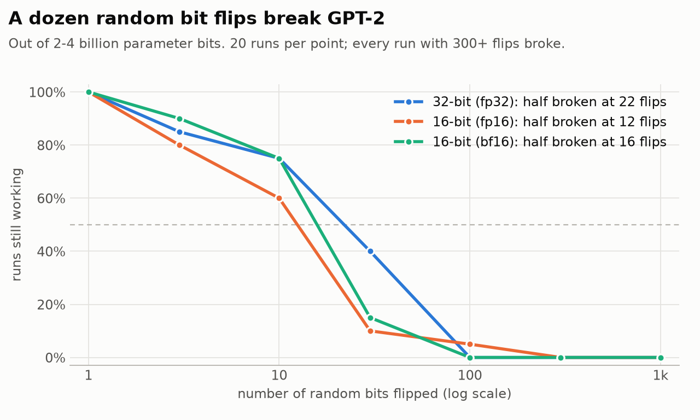
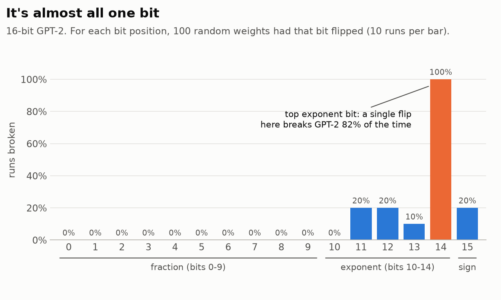
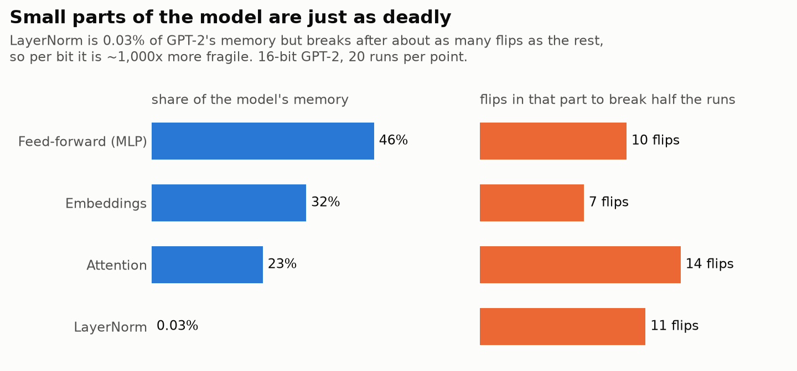
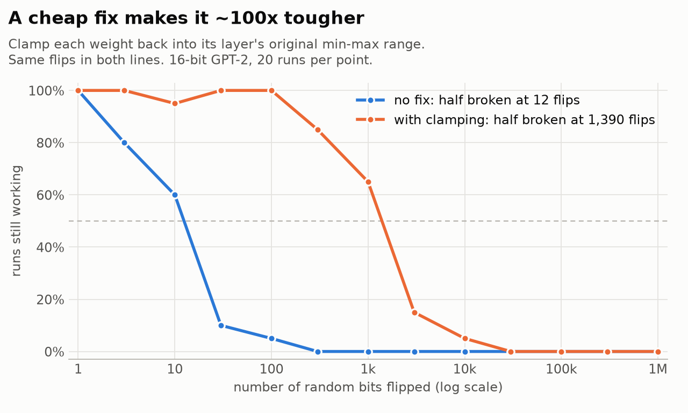
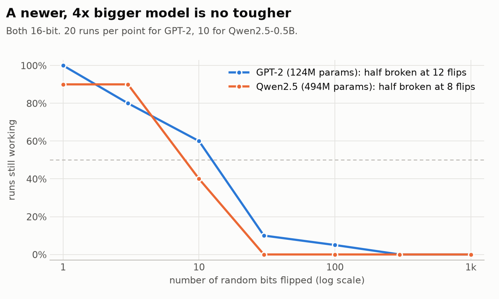

# How many cosmic rays can GPT-2 survive?

Cosmic rays striking memory chips occasionally flip a single bit. A language model is just its parameters sitting in memory, so how many of those flips can it take?

I flipped uniformly random bits in the parameters of GPT-2 (124M) and measured whether the model still worked: 2,580 runs in total across six experiments.

## What "broken" means

Every run is scored by perplexity on a fixed held-out text, the first 4,096 tokens of the WikiText-2 test set:

$$\text{PPL} = \exp\left(-\frac{1}{N}\sum_{i=1}^{N}\log p_\theta(x_i \mid x_{<i})\right)$$

where $p_\theta(x_i \mid x_{<i})$ is the probability the model assigns to the true next token. Lower is better; clean GPT-2 scores 28.2. A run counts as **broken** if its perplexity is more than 2× the clean model's, or if its logits contain NaN or Inf.

The 2× threshold barely matters, because damage is almost all-or-nothing. 98.6% of runs ended either within 10% of the clean perplexity or more than 10× above it. Here is what the two outcomes look like, with GPT-2 completing *"The Eiffel Tower is located in"* (greedy decoding):

| run | perplexity | output |
|---|---|---|
| clean | 28.2 | the heart of the city, and is the only place in the world where you can see the Eiffel Tower. |
| 10 flips, still working | 28.2 | the heart of the city, and is the only place in the world where you can see the Eiffel Tower. |
| 3 flips, broken | ∞ | heated heated heated heated heated heated heated heated heated heated heated heated … |
| 3 flips, broken | ∞ | the heart 124 124 124 124 124 124 124 124 124 124 124 124 … |
| 10 flips, broken | 1.7 × 10⁸ | Bane Bane Bane Bane Baneacheacheache Bane Bane Bane Bane … |

## Results

### 1. About a dozen flips is enough



In fp16, GPT-2's parameters take up about 2 billion bits. **Twelve random flips break it half the time**, and 300 flips broke every run. fp32 doubles the bit count but only raises the median to 22 flips.

### 2. It's almost all one bit



An fp16 number is 1 sign bit, 5 exponent bits and 10 mantissa (fraction) bits, with value $(-1)^s \times 2^{e-15} \times 1.m$. Mantissa flips change a parameter by a small relative amount, and the model tolerates them completely. Flipping the top exponent bit multiplies the value by $2^{16}$, turning a typical parameter like **0.02 into 1,311** (in fp32, the equivalent flip gives 6.8 × 10³⁶). One such outlier propagates through every later layer, so **a single flip of that bit breaks GPT-2 82% of the time**. A uniformly random flip hits that bit with probability 1/16, which is why about a dozen random flips is the typical breaking point.

### 3. Small parts are just as deadly



LayerNorm parameters are 0.03% of the model, yet flips confined to them break it about as quickly as flips confined to attention, the MLPs or the embeddings. Per bit, LayerNorm is roughly 1,000× more fragile.

### 4. A cheap fix makes it about 100× tougher



The damage comes from parameters becoming huge, so the mitigation is to store each tensor's clean min and max and clamp every parameter back into that range (NaNs become 0). On identical flips, the median breaking point moves from **12 to 1,390 flips**, and nearly every run survives 100 flips.

### 5. A newer, bigger model is no tougher



Qwen2.5-0.5B (494M parameters, 2024) breaks after about 8 flips. It also has 4× as many bits exposed, so at a given error rate it accumulates flips 4× faster.

## How long would it last?

Soft-error rates depend on altitude (the atmosphere absorbs most of the neutron flux) and on the memory technology. Published sea-level rates for DRAM range from about 0.56 to 1,000 FIT/Mbit (failures per 10⁹ device-hours per megabit), with modern hardware at the low end. The estimates below assume memory without ECC, as in most laptops and phones. Server memory typically has ECC, which corrects single-bit errors.

Time until fp16 GPT-2 has a 50% chance of being broken:

| environment | modern DRAM (0.56 FIT/Mbit) | older DRAM (1,000 FIT/Mbit) |
|---|---|---|
| Sea level | ~1,300 years | ~9 months |
| Denver (3.5× flux) | ~380 years | ~2.5 months |
| Airliner at 40,000 ft (300× flux) | ~4.5 years | ~1 day |
| Low Earth orbit | 9 minutes to 1.5 hours | (same) |

Orbit is a different radiation environment, so it uses a measured per-bit rate instead of a flux multiplier: 10⁻⁷ to 10⁻⁶ upsets per bit per day, which means hundreds to thousands of flips per day across GPT-2's parameters.

Sources:
- Modern DRAM (0.56 FIT/Mbit): Li, Shen, Huang & Chu, ["A Memory Soft Error Measurement on Production Systems"](https://sites.rochester.edu/michaelhuang/wp-content/uploads/2023/03/usenix07.pdf), USENIX ATC 2007. The 1,000 FIT/Mbit figure is within the 200–5,000 range of older lab studies that this paper summarizes.
- Denver: Actel, ["Effects of Neutrons on Programmable Logic"](https://ww1.microchip.com/downloads/aemDocuments/documents/FPGA/ProductDocuments/SupportingCollateral/serwp.pdf), 2002 ("more than three times higher in Denver than it is in New York").
- 40,000 ft: S. Wiley, ["NASA Aviation Activities and Space Weather"](https://ccmc.gsfc.nasa.gov/publicData/SWxWorkshops/2014/Wiley_aviationactivities.pdf), NASA GSFC, 2014 ("FL400 is 300X > neutron flux @ sea level").
- Orbit: Wang et al., ["A Case for Application-Aware Space Radiation Tolerance in Orbital Computing"](https://arxiv.org/abs/2407.11853), 2024.

Run `uv run python -m cosmic_gpt.cosmic` for the full table, including other number formats and your own error rates.

## Run it yourself

```bash
uv sync
uv run python -m cosmic_gpt.sweeps all   # all experiments, ~35 min on an M1 Pro; results/ has the outputs
uv run python -m cosmic_gpt.plots        # charts
uv run python -m cosmic_gpt.cosmic       # time-to-break table
uv run pytest                            # tests
```

<details>
<summary><b>Technical details</b></summary>

**Experiments** (`cosmic_gpt/sweeps.py`, one CSV per experiment in `results/`):

| # | what | runs |
|---|---|---|
| 1 | 1 to 1M random flips, in fp32, fp16 and bf16 | 20 per point |
| 2 | 100 flips all at the same bit position, for every position | 10 per bar |
| 3 | flips restricted to one part of the model (embeddings, attention, MLP, LayerNorm), fp16 | 20 per point |
| 4 | experiment 1's fp16 flips, then clamping | 20 per point |
| 5 | Qwen2.5-0.5B, fp16 | 10 per point |
| 6 | a single flip of the top exponent bit | 50 per format |

**Model and data.** HF `gpt2` on Apple MPS. The eval text is the first 4,096 GPT-2 tokens of WikiText-2-raw (test split), as four non-overlapping 1,024-token windows, so N = 4,092 predicted tokens. Log-probabilities are computed in fp32. Clean perplexity is 28.2 for fp32/fp16, 28.3 for bf16 and 14.3 for Qwen2.5-0.5B; each format is compared against its own clean value.

**Flipping.** Bits are chosen uniformly, without replacement, across all parameter bits, including biases and LayerNorm gains. GPT-2's input and output embeddings share memory, so they count once. Each trial restores the clean parameters first. Every trial has its own random seed and its exact flip list is saved in `results/flips/`. Lists over 1,000 flips are left out of the repo for size, and `uv run python -m cosmic_gpt.sweeps --replay <trial_id>` regenerates any trial exactly. Experiment 4 uses the same seeds as experiment 1, so both lines in chart 4 see identical flips.

**Clamping.** After the flips, NaNs become 0 and each tensor is clamped to its clean min and max. This assumes those two numbers per tensor are kept somewhere safe.

**Time to break.** flips/hour = FIT/Mbit × Mbit of parameters × flux multiplier ÷ 10⁹. Multipliers are relative to New York at sea level (the JESD89A reference). Only the parameters count as exposed memory, not activations or the KV cache. The table above uses the measured median from experiment 1 (12 flips for fp16). `cosmic.py` also prints a mean estimate built from experiments 2 and 6 (19 flips), which agrees: a geometric distribution with that per-flip risk has a median of ln 2 / p ≈ 13.

**Code.** `inject.py` (bit flipping, restore, clamp), `model.py` (loading, perplexity), `sweeps.py` (experiments), `plots.py` (charts), `cosmic.py` (time-to-break table), `tests/` (flip correctness).

</details>

## License

MIT, see [LICENSE](LICENSE).
